# 影汇 YingHui

A Flutter media manager and player for **Navidrome, Emby, qBittorrent,
Transmission and aria2** — one app to listen to music, watch video, and
manage downloads. Dark-first Material 3, 4 tabs (Home / Music / Video /
Downloads) plus a persistent mini-player.

> P0 skeleton + P1 servers. Nothing has been
> pushed, tagged or released, and no GitHub repo has been created.

## 界面样板图

设计样板图（英文占位文字，不是真机截图）。原图在
`docs/mockups/`；波浪形进度条的样板图没有收进来——已经决定
不换，保持现在的直进度条。

### 主页面

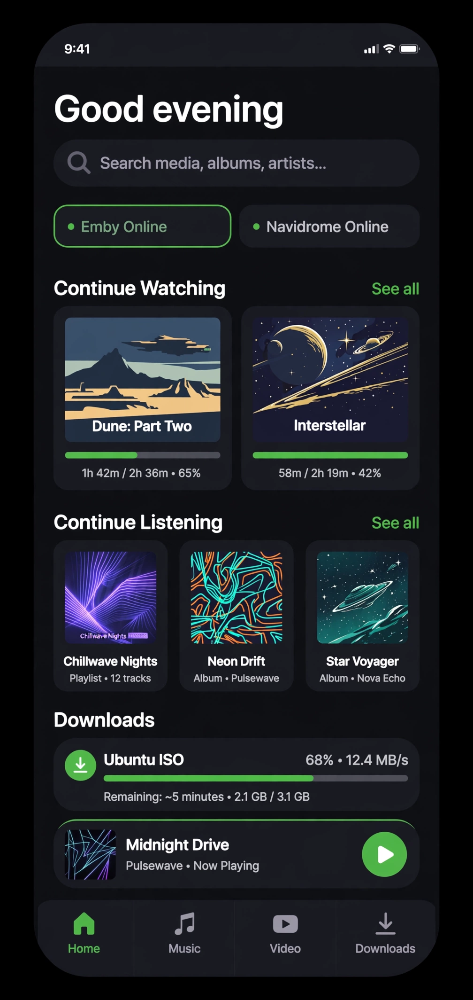 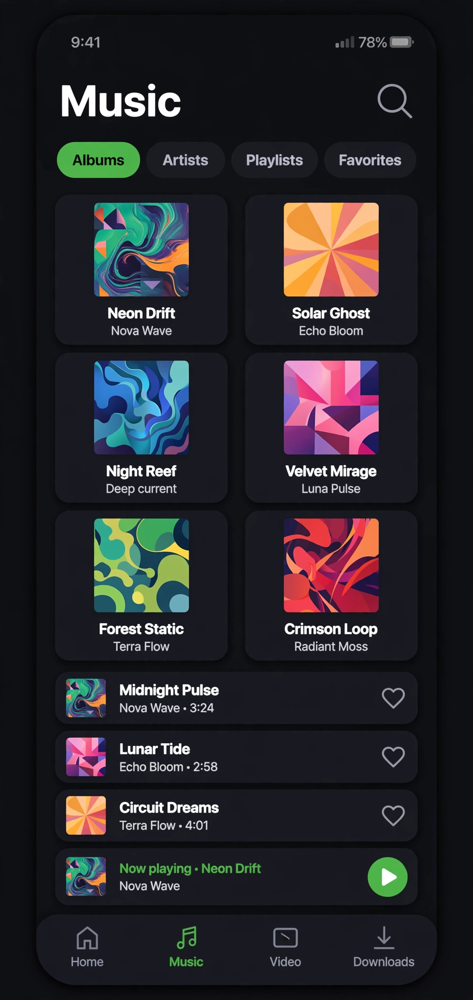 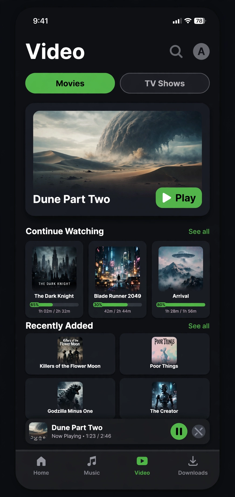

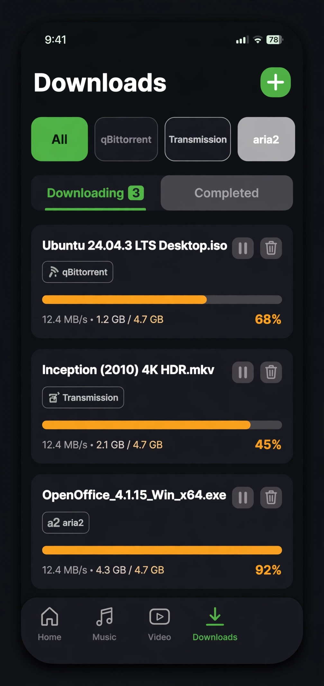 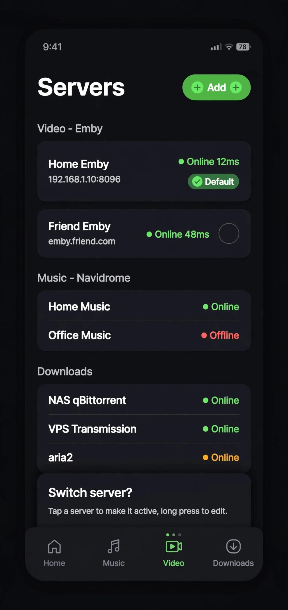

### 详情页

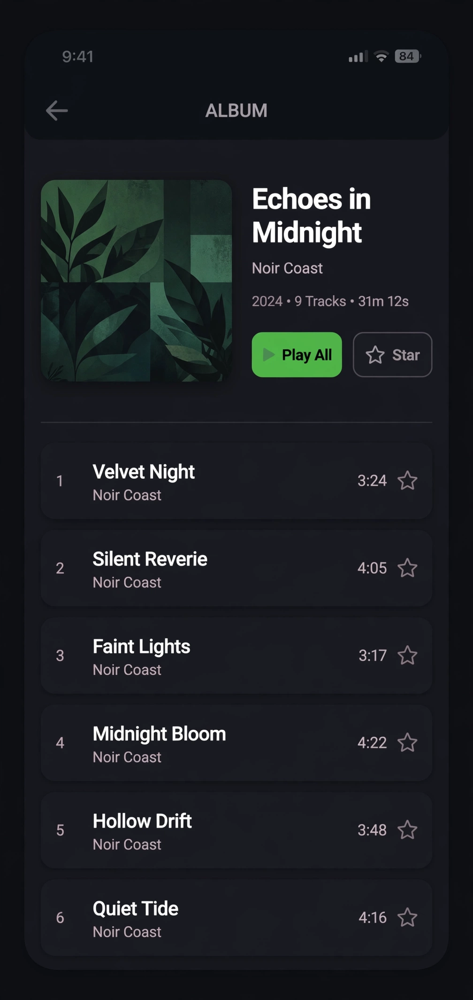 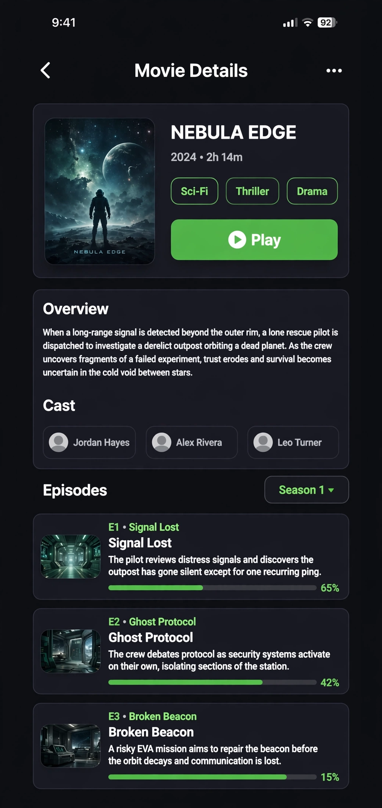 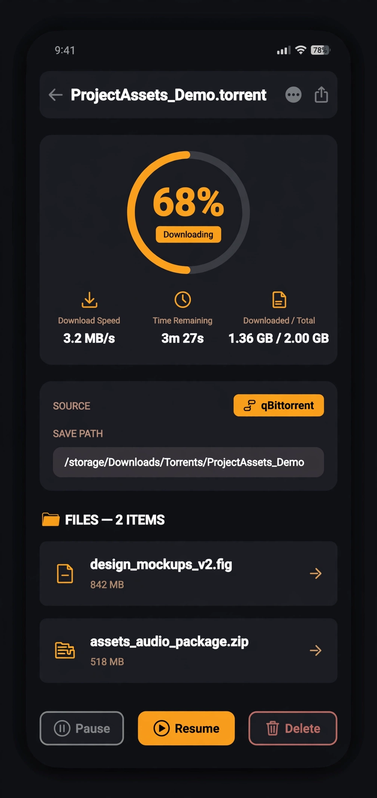

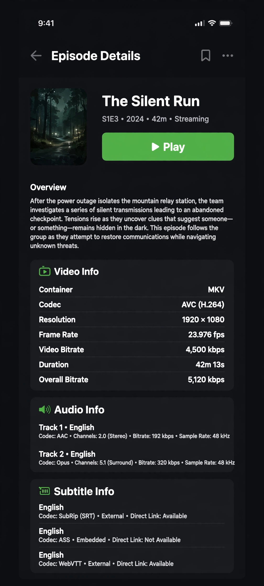 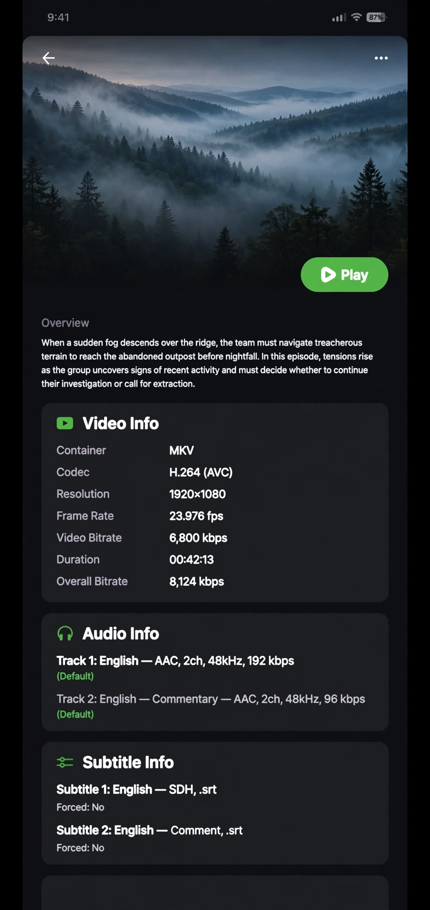

单集详情页桌面端（视频信息和音频信息两张卡并排）：

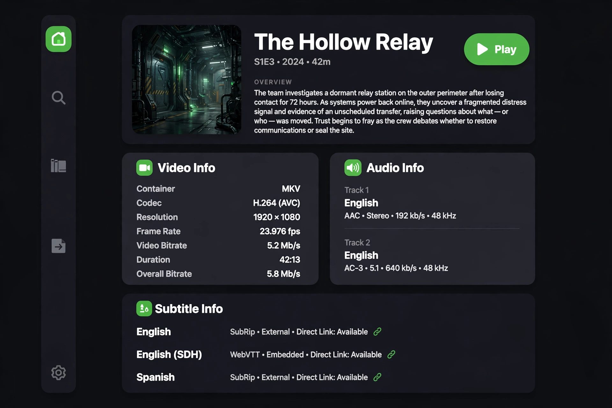

音乐详情页桌面端（内容居中限宽 1000，单列不变）：

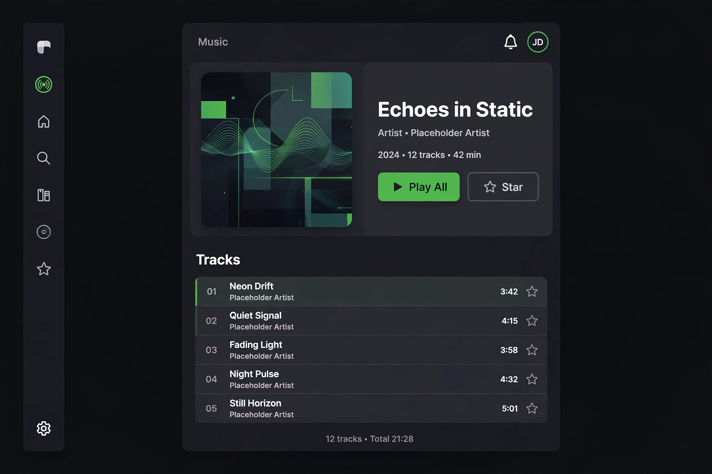

### 播放器

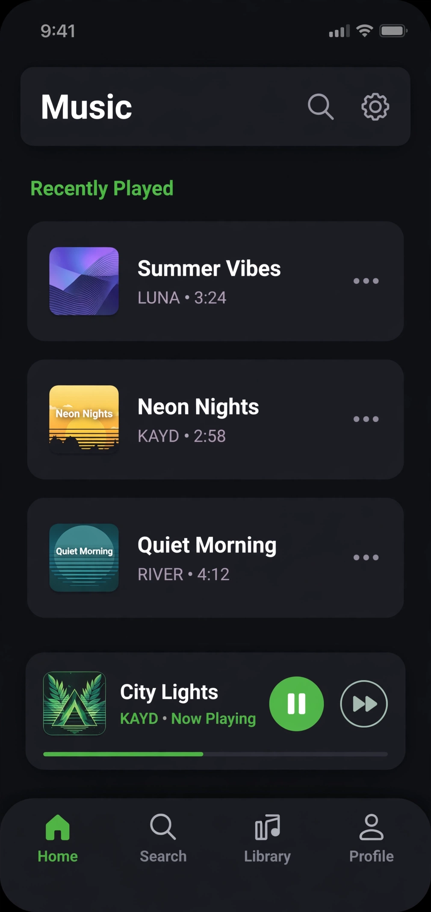 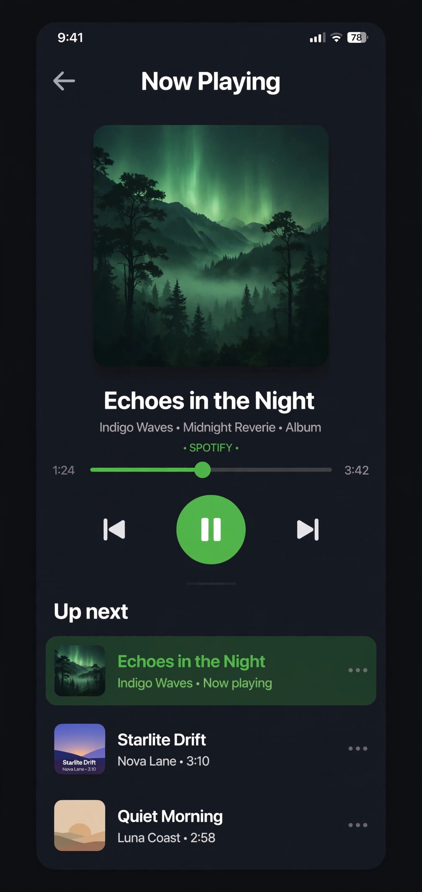

桌面端音乐播放器（两列）和视频播放器（键盘快捷键）：

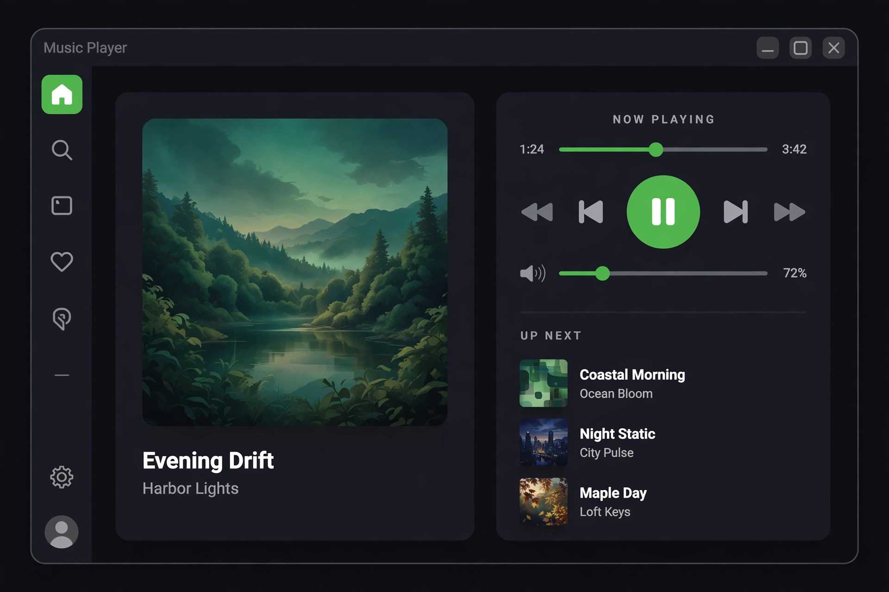

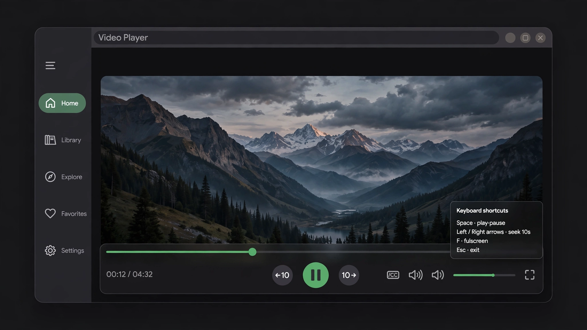

### 播放器风格参考（Settings → 播放器风格）

下面四张是风格参考图，不是 App 现在的样子——默认风格就是
上面那套绿色 M3，选了别的风格才换：

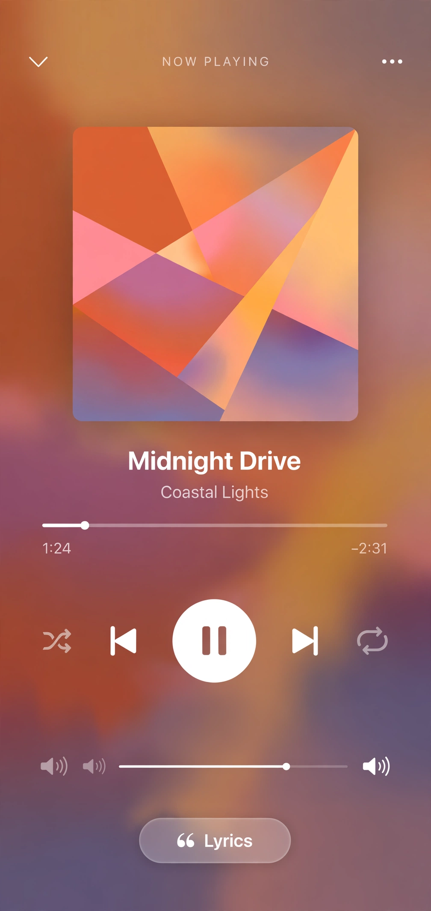 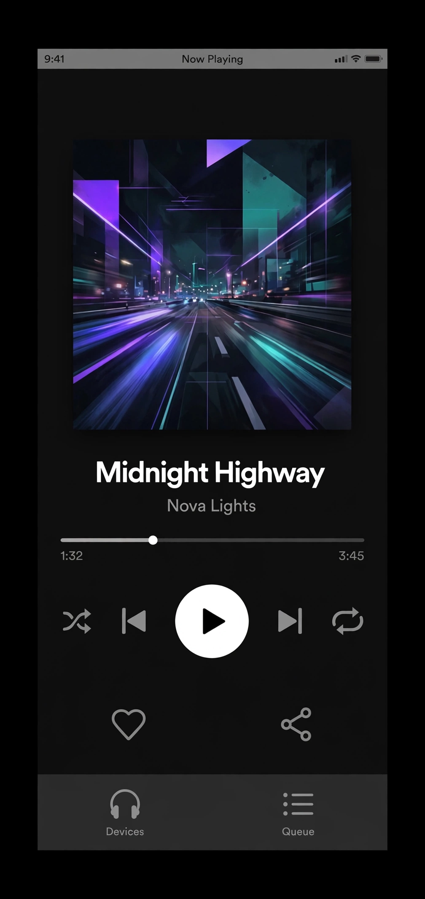 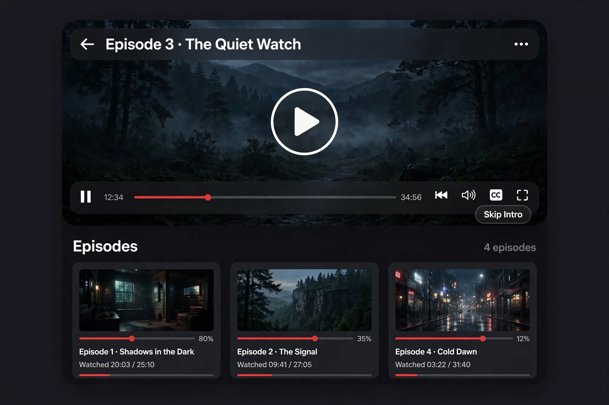 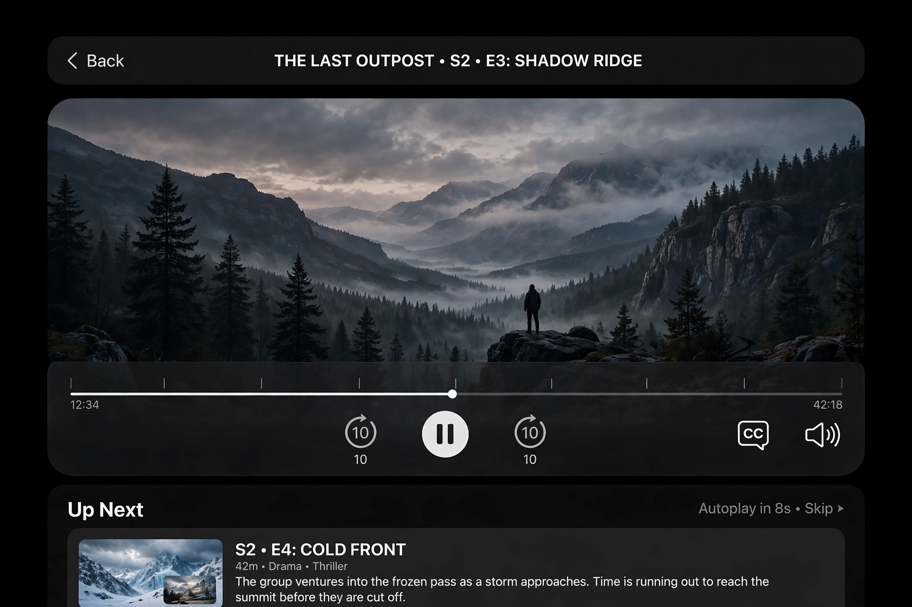

## Architecture

```
Server  ->  per-service ApiClient  ->  unified model  ->  pages
```

Each service gets **its own native API client** in `lib/data/api/`
— there is no shared generic wrapper hiding them:

| Service | Client | Protocol |
|---|---|---|
| Navidrome | `subsonic_client.dart` | Subsonic API `/rest/*`, salted-MD5 auth (`u,t,s,c,v,f=json`) |
| Emby | `emby_client.dart` | REST, `POST /Users/AuthenticateByName`, `X-Emby-Authorization` header, `X-Emby-Token` |
| qBittorrent | `qbittorrent_client.dart` | Web API v2, `POST /api/v2/auth/login` (SID cookie), `/api/v2/torrents/*` |
| Transmission | `transmission_client.dart` | JSON-RPC `POST /transmission/rpc`, 409 `X-Transmission-Session-Id` retry |
| aria2 | `aria2_client.dart` | JSON-RPC `POST /jsonrpc`, `token:` prefix as first param |

Unified models in `lib/data/models/`: `Track`, `Album`, `VideoItem`,
`DownloadTask` (source enum qBittorrent / Transmission / aria2).

Servers are modelled in `lib/core/models/server.dart`:
`Server{id, type, name, host, port, username, token, isDefault}`.
Secrets (`token`: Navidrome password, Emby access token, qB/Transmission
password, aria2 RPC secret) are stored only in
`flutter_secure_storage`; non-secret fields go to Drift (SQLite)
(`AppDatabase`, `lib/data/db/app_database.dart`, `servers` table).
No host, username, password, token or API key is hard-coded anywhere,
and secrets are never logged.

## P1 — servers (Drift + structured connection test + seeding)

- **Drift** (`drift` + `drift_flutter`, codegen via `drift_dev` /
  `build_runner`, `lib/data/db/app_database.dart`): `servers` table
  (id, type, name, host, port, username, isDefault — no secrets),
  plus placeholder tables `playback_history`, `favourites`,
  `download_tasks` for later phases. On first load, a P0
  `shared_preferences` server list (`yinghui_servers`) is imported
  once into Drift and the old key cleared.
- **Structured connection test** (`lib/core/models/connection_result.dart`):
  `ok` / `needsAuth` / `unreachable`, with server version/name when
  reported. The Servers page shows each state distinctly (green /
  amber / red) with a per-server Test button.
  - Navidrome: unauthenticated `/rest/ping.view` probe — a Subsonic
    `status: failed` code 10/40 is `needsAuth`, not unreachable.
  - Emby: `GET /System/Info/Public` (no auth) — HTTP 200 with
    `ProductName: Emby Server` is `needsAuth`; a valid token makes
    `/System/Info` return `ok`.
  - qBittorrent: `GET api/v2/app/version` without login — HTTP 403 is
    `needsAuth`. Requests use **relative paths** (no leading `/`) so a
    subpath in the server URL is preserved: `https://host/qb/` +
    `api/v2/...` = `https://host/qb/api/v2/...` (Dio drops the base
    path for leading-slash paths).
- **Seeded servers** (first run only, no credentials — fill them in
  inside the app; a deleted server is never re-seeded):
  Navidrome `https://sg.kass.qzz.io/`, qBittorrent
  `https://sg.kass.qzz.io/qb/`, Emby `https://cf.imetyou.top`
  (default), all port 443, empty username/token.

## Run in fake mode (default)

```sh
flutter pub get
flutter run
```

P0 defaults to a fake repository (`FakeMusicRepo` / `FakeVideoRepo` /
`FakeDownloadRepo` in `lib/data/repositories/fake_repos.dart`) with
placeholder English data, so the UI runs offline with no credentials —
the same pattern as douya. Real clients are used only when a server is
added (Settings → Servers → +) and its connection is tested.

Servers page: list with an online status dot, tap a row to make it the
default, long-press to edit, swipe to delete. Add picks the type first,
then the form, and **Test Connection** runs the native client's check
before save.

## What P1 does NOT do

- **No real login yet.** No credentials were given, so no
  authenticated list/playback was tested against the seeded servers.
- **No real playback.** The mini-player is a placeholder (play/pause
  toggles local state only); `media_kit` is P2/P3.
- **No live authenticated test.** The clients have not been tested
  against yang's own servers with a login — only the unauthenticated
  probes above (Navidrome ping, Emby public info, qB 403) and the
  offline unit tests below.
- **No device verification.** `flutter analyze` and `flutter test`
  pass on this machine; no Android/iOS build or on-device run has been
  done (no Android SDK on this VM; CI is the Android route).

## P2 — Music (Navidrome, real Subsonic API)

- **Subsonic client extended** (`lib/data/api/subsonic_client.dart`):
  `getArtists`, `getAlbum` (album + tracks), `getStarred2`, `star` /
  `unstar` (id + albumId), `getPlaylists` / `getPlaylist`, `getGenres`,
  and `searchAll` (songs + albums + artists in one `search3` call).
  Salted-MD5 auth unchanged; no secrets logged.
- **RealMusicRepository** (`lib/data/repositories/music_repository.dart`):
  one Subsonic client per credentialed Navidrome server, results merged
  and deduped by title+artist(+album); a server that fails is skipped,
  it never blanks the list. With no Navidrome credentials the P0 fake
  repo is the fallback, but the Music page shows an explicit
  "No Navidrome account yet" empty state (with an Open Servers button)
  instead of silently presenting demo data as real data.
- **Playback — media_kit 1.2.6** (libmpv/FFmpeg, the settled player;
  resolved on the first `pub get`, no fallback was needed):
  `lib/features/player/player_service.dart` — `PlayerBackend`
  interface, `MediaKitPlayerBackend`, queue, play/pause/next/prev/seek,
  position/duration streams, auto-advance on track completion. The
  backend is created lazily on first play, so the app boots and tests
  run without native libmpv. The mini-player now drives the real
  service, and `now_playing_page.dart` is a full-screen player (cover,
  seek bar, queue list). Note: media_kit also exports a `Track` class,
  so the import uses `hide Track` to avoid colliding with our model.
- **Music UI**: chips Albums / Artists / Playlists / Favorites;
  2-column album grid with cached cover art (auth is in the cover URL,
  so no extra headers), pull-to-refresh, infinite scroll; search field
  (`search3`); album detail page (cover, Play All, per-track star);
  playlist track lists; star toggles call the server and record a
  local favourite.
- **Persistence**: the P1 Drift `favourites` and `playback_history`
  tables are now used (`lib/data/repositories/playback_store.dart`) —
  a history row on track start, resume position updated on pause/stop.
  No new persistence layer.
- **Emby audio is NOT wired in P2**: `EmbyClient.getAudioItems` exists
  but the Music tab only uses Navidrome (Subsonic). Emby music is a
  later-phase option.

## What P2 does NOT do

- **No live test against the user's Navidrome server.** No
  credentials were given, so all real-server behaviour is covered by
  mocked-Dio tests only; no authenticated list/playback was run
  against `https://sg.kass.qzz.io/`.
- **No device verification.** `flutter analyze` and `flutter test`
  pass on this machine; no Android/iOS build or on-device run has been
  done (no Android SDK on this VM; CI is the Android route).

## P3 — Video (Emby, real API)

- **Emby client** (`lib/data/api/emby_client.dart`): user id via
  `GET /Users/Me` (cached); `getUserViews`, `getResumeItems`
  (continue watching, with `PlaybackPositionTicks`), `getItemDetail`
  (overview, cast, genres, subtitle streams), `getSeasons` /
  `getEpisodes`, `getPlaybackInfo` (`POST /Items/{id}/PlaybackInfo`),
  `reportProgress` (`POST .../PlayingItems/{id}/Progress`) and
  `markPlayed` (`POST .../PlayedItems/{id}`). Poster/backdrop URLs
  now carry the `api_key` query param so images load without extra
  headers. Server name/version are parsed at runtime, never
  hard-coded.
- **RealVideoRepository** (`lib/data/repositories/video_repository.dart`):
  one Emby client per credentialed Emby server, results merged and
  deduped by title+year; one dead server never blanks the list. With
  no Emby credentials the Video page shows an explicit "No Emby
  account yet" empty state (with an Open Servers button).
- **Transcoding decision** (`lib/data/repositories/playback_decision.dart`,
  pure and unit-tested): direct play only for mp4/m4v/mov + h264 +
  aac/mp3 when the server allows it; everything else goes through
  **server-side Emby transcoding** (HLS `master.m3u8`). No local
  FFmpeg in P3. Quality picker: Direct / 1080p (8 Mbps) / 720p
  (4 Mbps) / 480p (1.5 Mbps); a non-Direct quality always forces
  transcoding. Subtitles are burned into transcodes
  (`SubtitleStreamIndex`) or loaded as an external SRT track on
  direct play.
- **Video playback — media_kit_video 1.3.1** (same media_kit family
  as P2; resolved on the first `flutter pub get`, no fallback was
  needed): `lib/features/player/video_player_service.dart` —
  `VideoBackend` interface + `MediaKitVideoBackend` (lazy, so the app
  boots and tests run without native libmpv), and
  `lib/features/player/video_player_page.dart` — `Video` widget,
  tap-to-show controls that auto-hide after 3s while playing (stay
  visible when paused), seek bar with times, fullscreen toggle,
  subtitle + quality pickers (re-open at the current position),
  resume from the Emby resume position, position saved to Drift on
  pause/stop/dispose, played marked on completion.
- **Video UI**: hero poster with Play/Resume, Continue Watching 2:3
  posters with green progress, Recently Added, Movies/Series chips,
  pull-to-refresh, infinite scroll, search (`SearchTerm`);
  `video_detail_page.dart` has backdrop, overview, genres, cast,
  season dropdown + episode list with per-episode progress.

## What P3 does NOT do

- **No live test against the user's Emby server.** No credentials
  were given, so all real-server behaviour is covered by mocked-Dio
  tests only; no authenticated list/playback was run against
  `https://cf.imetyou.top/`.
- **No device verification.** `flutter analyze` and `flutter test`
  pass on this machine; no Android/iOS build or on-device run has been
  done. Real libmpv video playback and server-side transcoding are
  unproven on a device.
- **Emby audio remains unwired** (Music is Navidrome-only).

## P4 — Downloads (qBittorrent / Transmission / aria2, real queues)

- **Clients completed**: qBittorrent already had `torrents/info` /
  `add` / `pause` / `resume` / `delete`; its task parsing now also
  carries `eta`, `save_path` and `hash`. Transmission `torrent-get`
  now requests `eta`, `downloadDir`, `hashString`, and gained
  `torrent-set-location`; `torrent-add` accepts a `download-dir`.
  aria2 gained `tellStopped` and `tellStatus`, `tellAll` now merges
  active + waiting + stopped, and `addUri` accepts a `dir` option.
  Auth is unchanged (qB SID cookie, Transmission 409 session-id
  retry, aria2 `token:` prefix); no secrets are logged.
- **RealDownloadRepository**
  (`lib/data/repositories/download_repository.dart`): one native
  client per usable downloader server (a server with a username or
  token, or a user-added server — the latter covers no-auth
  Transmission/aria2; the seeded qBittorrent server has empty
  credentials and a `seed-` id, so it is excluded until the user
  fills in its login), merged into one unified queue sorted
  downloading-first then by progress. One dead server never blanks
  the list — its error is shown inline per server. With no usable
  downloader the page shows an explicit "No downloader account yet"
  empty state. Add / pause / resume / delete / retry dispatch to the
  right native client. Polling: a 5s timer while the Downloads page
  is visible, stopped on dispose (one place, in the repository).
- **Persistence**: the P1 Drift `download_tasks` table — every live
  task is upserted on refresh, and rows the servers no longer return
  stay visible with their last-seen state until the user deletes
  them in the app.
- **Downloads UI** (`lib/features/downloads/downloads_page.dart`):
  filter chips All / qBittorrent / Transmission / aria2 plus status
  chips Downloading / Completed / Paused / Failed; unified rows with
  name, source label, **amber** progress bar (green stays for
  playback), speed, downloaded/total size, percentage, ETA and save
  path; pause/resume, retry (failed) and delete buttons — delete
  asks whether to delete the downloaded files too. The `+` button in
  the app bar opens a sheet: magnet link / torrent URL / `.torrent`
  URL, pick a credentialed downloader (default = default downloader
  server), optional save path. The Home download row now shows the
  same repository's active downloads and aggregate speed, amber
  only.
- **These are server-side downloads** on the NAS/VPS (qBittorrent,
  Transmission, aria2). Nothing is downloaded to the phone itself
  in P4.

## What P4 does NOT do

- **No live test against the user's qBittorrent server.** No
  credentials were given, so all real-server behaviour is covered by
  mocked-Dio tests only; nothing was run against
  `https://sg.kass.qzz.io/qb/` with a login.
- **No Transmission or aria2 server address was given at all** —
  only qBittorrent was seeded. Add one in Servers to use it.
- **No device verification** (analyze + tests only on this VM).
- **No local device downloads** — P4 manages downloads on the
  servers; downloading files to the phone is not part of this phase.

## P5 — Polish (Settings, theme, cache, About, release preparation)

- **Settings page** (`lib/features/settings/settings_page.dart`,
  reached from the app shell's gear button): Appearance / Playback /
  Downloads / Data / About. Appearance: theme mode System / Light /
  Dark, M3 seed presets (Emby green `#52B54B` default, forest, teal,
  slate blue), font scale 80–130%, dynamic colour toggle (Android
  12+, via `dynamic_color`, used only when switched on). Playback:
  default video quality (Auto / Direct / 1080p / 720p / 480p — Auto
  means the P3 decider decides), audio max bitrate for Subsonic
  streams (0 = original), subtitles on/off, resume playback.
  Downloads: default downloader (from credentialed downloaders),
  default save path, polling interval 5/10/30 s. Data: search
  history (save/clear), clear playback history, clear favourites
  (with confirm dialogs), clear image cache (size shown, formatted
  KB/MB). About: logo, name 影汇 YingHui, version from
  `--dart-define=APP_VERSION` (`dev` builds show as 开发版 — the
  version is never hard-coded), package `com.yinghui.app`, a
  "what this app does / does not do" note (own servers only, no
  account creation), open-source licences (`showLicensePage`).
- **SettingsService** (`lib/core/settings.dart`): `ChangeNotifier`,
  persisted in `shared_preferences` (`yinghui_*` keys), applied
  app-wide from `main.dart` (theme mode, seed, font scale via
  `MediaQuery.textScaler`, dynamic scheme). Player styles
  (`yinghui_music_player_style`, `yinghui_video_player_style`:
  music `default` / `appleMusic` / `spotify`, video `default` /
  `netflix` / `appleTv`; unknown values fall back to `default`) are
  picked in Settings under 播放器风格 and restyle the full-screen
  players live. Pure helpers:
  `formatBytes`, `appVersionLabel`.
- **Theme** (`lib/core/theme.dart`): `YingHuiTheme.build` takes a
  seed + brightness; dark = the existing dark-first palette
  (`#0F1013` / `#1A1C22`); light = M3 light from the same seed with
  pale mint `#C8E6C9` container tones. Hard-coded dark colours were
  removed from the pages: Home search bar and progress tracks, the
  mini-player container and track, the Downloads progress track, and
  the Video Continue Watching track now read the theme
  (`surfaceContainerHighest` / `onSurface` alpha). The amber =
  download / green = playback rule was checked everywhere and holds:
  download rows and the Home download row are amber, music/video
  progress is the theme primary (green seed).
- **Shared states** (`lib/core/widgets/state_views.dart`):
  `LoadingView` / `ErrorView` (message + Retry) / `EmptyView`
  (icon/title/subtitle/optional action) now back Home, Music, Video,
  Video detail, and Downloads — the pages no longer duplicate their
  own loading/error/empty widgets.
- **Cache**: image cache is `cached_network_image`'s
  `DefaultCacheManager`; the Settings page shows its size (bytes
  under `<temp>/libCachedImageData`, formatted by `formatBytes`)
  with a Clear button (confirm dialog). Drift DB size is not shown:
  drift_flutter manages the file and exposes no public path, so it
  was skipped deliberately.
- **Launcher icons**: generated with `flutter_launcher_icons`
  0.14.4 from `assets/logo.png` (the code-drawn flat light logo),
  Android adaptive icons from `assets/logo-foreground.png` /
  `assets/logo-background.png`; config in
  `flutter_launcher_icons.yaml`, regenerate with
  `dart run flutter_launcher_icons`. (Note: 0.14.x needs `macos:` /
  `windows:` as maps, not booleans.) Display name is 影汇 on
  Android (`android:label`), iOS (`CFBundleDisplayName`), macOS
  (`PRODUCT_NAME`), Windows (`FileDescription` / `ProductName`).
- **Android signing**: `android/app/build.gradle.kts` reads
  `android/key.properties` when present (same pattern as douya) and
  falls back to the debug key without it. The keystore is never in
  the repo; CI writes `key.properties` from Secrets.
- **Release workflow**: `.github/workflows/release.yml` (tag `v*`
  or manual dispatch; test job first, then Android signed split
  APKs, iOS unsigned IPA, macOS DMG, Windows ZIP on windows-2022,
  `APP_VERSION` from the tag passed as `--dart-define` to all
  builds, prerelease). No API key/secret secrets are needed —
  credentials live in the app. **Not run, not pushed, not tagged.**
- **What P5 does NOT do**: no device build/run, no CI run, no
  release published, no live server test. The first CI run is the
  first real compile check of the platform projects and the
  workflow.

## How to release (for yang to order later)

1. Set the 4 Android signing Secrets in the repo:
   `ANDROID_KEYSTORE_BASE64`, `ANDROID_KEYSTORE_PASSWORD`,
   `ANDROID_KEY_ALIAS`, `ANDROID_KEY_PASSWORD`. (Without them the
   Android job fails on purpose — it never falls back to a
   throwaway key, or a later formally-signed build could not
   upgrade over the first install.)
2. Push `main`, then create the tag (pubspec stays `0.1.0+1`; the
   version comes from the tag):
   `git tag v0.1 && git push origin v0.1`
3. The `Release` workflow runs: test → 4 platform builds →
   prerelease with 6 artifacts (`YingHui-v0.1-*.apk`,
   `YingHui-v0.1-unsigned.ipa`, `YingHui-v0.1-macos.dmg`,
   `YingHui-v0.1-windows-x64.zip`).
4. Install the APK on the device and check the About page shows
   `Version v0.1` (not 开发版).

## Tests

```sh
flutter test
```

`test/api_logic_test.dart` covers pure logic only, offline:

- Subsonic auth params: `t = md5(password + salt)`, `u/s/c/v/f=json`,
  different salts give different tokens, `streamUrl` shape.
- Transmission 409 retry: a 409 with `X-Transmission-Session-Id` is
  retried once with the learned session id.
- aria2 token prefix: the secret is the first param as `token:<secret>`;
  no secret means no token param; the JSON-RPC body carries it.
- `Server` JSON round-trip (token excluded) and `baseUrl` normalisation
  (bare host → `http://host:port`; full URL kept as-is).

`test/widget_test.dart` is a smoke test: the app boots to the Home tab
in fake mode.

`test/music_p2_test.dart` covers P2, all with mocked Dio / a fake
player backend (no live server, no native audio):

- Subsonic music endpoints: `getAlbumList2` (cover art → URL),
  `searchAll`, `getAlbum`, `getArtists` (index flattening),
  `getStarred2`, `star`/`unstar`, playlists, genres.
- `RealMusicRepository`: merge + dedupe across two servers, one
  server down does not blank the list, no-credentials fallback,
  star toggle (server call + local favourite).
- `PlayerService`: playQueue opens the stream URL and starts playing,
  next/previous (restart-then-back), pause saves position, track
  completion auto-advances, empty stream URL opens nothing; history
  rows are written on track start.
- Widget test: the Music page shows the "No Navidrome account yet"
  empty state with no credentials.

`test/video_p3_test.dart` covers P3, all with mocked Dio / a fake
video backend (no live server, no native video):

- Emby video endpoints: `getUserViews`, `getResumeItems` (progress +
  resume position), `getItemDetail` (cast, genres, subtitle streams),
  `getSeasons` / `getEpisodes`, `getPlaybackInfo` (media sources),
  `subtitleUrl` (DeliveryUrl preferred, else Stream.srt),
  `transcodeUrl`, `imageUrl` (api_key), `reportProgress` /
  `markPlayed` endpoint shapes.
- `PlaybackDecider`: mp4/h264/aac direct-plays; mkv/hevc/dts, ac3
  audio, and a server refusing direct play all transcode; 720p forces
  transcode at 4 Mbps; subtitle index is carried through.
- `RealVideoRepository`: merge + dedupe across two servers, one
  server down does not blank the list, no-credentials fallback,
  `decidePlayback` direct vs transcode URLs, series detail grouping.
- `VideoPlayerService`: open at the resume position, pause saves
  position, completion fires once, empty URL opens nothing, subtitle
  URL forwarding; history rows are written on open.
- Widget tests: the Video page shows the "No Emby account yet" empty
  state with no credentials; the video player page shows
  "Could not play" when the playback decision fails.

`test/download_p4_test.dart` covers P4, all with mocked Dio (no live
server, no native downloads):

- qBittorrent `torrents/info`: state mapping (downloading / paused /
  completed / failed), progress, speed, ETA, save path, hash; `add`
  posts to `api/v2/torrents/add` with `savepath`.
- Transmission `torrent-get`: status mapping, `percentDone`, `eta`,
  `downloadDir`, `hashString`; the 409 session-id retry resends the
  request; `torrent-add` passes `download-dir`; `torrent-set-location`
  works.
- aria2 `tellActive` / `tellWaiting` / `tellStopped` shapes, name and
  save path from the file path, `token:` as the first RPC param,
  `tellStatus` by GID.
- `RealDownloadRepository`: merge across all three downloaders,
  downloading-first-then-by-progress sort, one server down does not
  blank the list (error recorded per server), add/pause/resume/delete
  dispatch to the right native client, persisted tasks survive a
  refresh where the server omits them and are removed by in-app
  delete, seeded qBittorrent with empty credentials is not usable.
- Widget test: the Downloads page shows the "No downloader account
  yet" empty state with no credentials.

`test/settings_p5_test.dart` covers P5:

- `SettingsService` persistence round-trip (theme mode, seed index,
  font scale, video quality, audio bitrate, subtitles, resume,
  polling interval, dynamic colour) through a real
  `SharedPreferences` mock; font scale clamps to 0.8–1.3; search
  history dedupes and caps at 20; `effectiveVideoQuality` maps Auto
  to Direct.
- `formatBytes` (B / KB / MB) and `appVersionLabel` (`dev` →
  开发版).
- Widget test: the Settings page renders all five sections plus the
  name, version and Servers row (tall viewport, since the page is a
  lazy ListView).

## Batch 2 — episode detail, download detail + hash, global persistence, desktop layout

- **Episode detail** (`lib/features/video/episode_detail_page.dart`):
  tapping an episode in the series detail page now opens its own page
  instead of playing directly (the series Play button still plays the
  first unplayed episode). Header (poster, S/E number, year, duration,
  overview, Play/Resume) plus three sections from the Emby
  MediaStreams/MediaSources the server actually returned — a missing
  field shows "—", no media source shows "暂无媒体信息": 视频信息
  (container, codec, resolution, frame rate, video bitrate, duration,
  overall bitrate), 音频信息 (one row per audio stream: language,
  codec/格式, channels, 码率 kbps, sample rate, default/forced), 字幕信息
  (one row per subtitle stream: language, codec/格式, default/forced,
  embedded vs external, DeliveryUrl presence; display-only). To feed
  it, `RealVideoRepository.itemDetail` now also fetches PlaybackInfo
  (a failure there never breaks the detail page), and
  `EmbyClient.parseMediaSources` keeps Channels / SampleRate /
  FrameRate / IsDefault / IsForced / IsExternal / DisplayTitle.
- **Download detail** (`lib/features/downloads/download_detail_page.dart`):
  tapping a task card opens it (the card's pause/resume/delete buttons
  keep working). Amber circular progress, speed, remaining time,
  downloaded/total, source, save path, file list (aria2 only so far —
  qB/Transmission file lists are not fetched), and only one of
  Pause/Resume depending on status (the mockup wrongly showed both).
  磁力详情: magnet URI (reconstructed from the hash when only the hash
  is known), full hash (monospace, selectable), original download link,
  each with a copy button ("已复制" snackbar) shown only when the value
  exists. The original add input is persisted in the Drift
  `download_tasks.sourceInput` column (schema v2, migration adds the
  column) so it survives a restart; live tasks re-attach it on refresh.
- **qB hash download**: the add sheet and `RealDownloadRepository`
  accept a bare torrent hash (40 hex SHA-1/v1 or 64 hex SHA-256/v2),
  sent as `magnet:?xt=urn:btih:<hash>` — qB's `torrents/add` takes
  magnet URLs and there is no hash-only endpoint. Wrong length or
  non-hex input is rejected before any network call.
- **Global persistence** (`lib/core/app_state.dart`, `AppStateStore`):
  last tab, last music track + queue + position (restored into the
  mini-player on boot, never auto-played — pressing play opens the
  stream and seeks to the saved position), last video + position
  (recorded on play and on player dispose), download source/status
  filters. `shared_preferences`, keys `yinghui_last_tab`,
  `yinghui_last_music`, `yinghui_last_video`,
  `yinghui_download_source`, `yinghui_download_status`. No secrets.
  `main.dart` loads the store before the first frame so the shell
  starts on the saved tab.
- **Desktop layout** (`lib/core/widgets/desktop_layout.dart`): wide
  means width >= 1024 (the shell's nav switch stays at 800).
  `CenteredContent` caps detail pages (album, video, episode,
  download) at 1000 wide; `ResponsiveTwoColumn` puts the episode
  media-info sections and the download detail info blocks side by
  side on desktop, stacked on phones; music and home grids are
  2 columns on phones, 4 on desktop. The video page has horizontal
  rows, not a grid, so it only gets the centred width.

`test/batch2_test.dart` covers this batch (21 tests, mocked Dio /
fakes, no live server): hash validation + magnet building, hash add
sends the magnet URI and persists the input (invalid hash: zero
client calls), Emby stream parsing (channels/sample rate/frame rate/
flags), `AppStateStore` round-trip + corrupt-data tolerance,
`PlayerService.restoreQueue` (no auto-play; togglePlay opens and
seeks), episode detail widget (info sections + empty state + wide
build), download detail widget (magnet/copy/single pause-resume),
desktop helpers (column counts, centred width).

## Player styles (Settings → 播放器风格)

- **Settings** (`lib/core/settings.dart`): `musicPlayerStyle`
  ('default' | 'appleMusic' | 'spotify') and `videoPlayerStyle`
  ('default' | 'netflix' | 'appleTv'), keys
  `yinghui_music_player_style` / `yinghui_video_player_style`,
  defaults 'default', unknown stored values fall back to 'default'.
  Changing either restyles the open player page live (the pages listen
  to `SettingsService`). Text labels only — no brand logos or
  trademarked assets.
- **Music** (`lib/features/player/now_playing_page.dart`): default is
  the current M3 green layout, unchanged. Apple Music: blurred cover
  background (plain dark when there is no cover), white play button,
  remaining time on the right end of the slider, volume slider wired
  to the real player volume (`PlayerService.volume` /
  `setVolume`, clamped 0–1, through the existing backend interface).
  Spotify: pure black background, white play button, heart wired to
  the existing track favourite, Queue button scrolling to the Up next
  list. Mini player is unchanged in all styles. Deliberately left
  out: shuffle/repeat (PlayerService has no such mode — no dead
  buttons), a Devices row (no casting support), lyrics.
- **Video** (`lib/features/player/video_player_page.dart`): default
  is the current M3 green layout, unchanged. Netflix: red progress
  bar and red accents, Next Episode button only when a next episode
  is actually known (series context from the detail page). Apple TV:
  ±10s buttons wired to real seek, and an Up Next card at the end of
  playback (next episode + 10s autoplay countdown, Play now /
  Dismiss, timer cancelled on dispose/tap). Deliberately left out:
  Skip Intro (Emby provides no intro timestamps) and chapter markers
  (no chapter data exists in the app).

`test/player_styles_test.dart` covers this batch (16 tests): settings
round-trip + invalid-value fallback, volume clamping, the Settings
page section, each variant's distinguishing elements, and live
restyling on a style change.

## Desktop players

- **NowPlayingPage** (`lib/features/player/now_playing_page.dart`):
  width >= 1024 gets a two-column layout inside the shared 1000px
  centred content — left column large cover (340px) + title/artist,
  right column seek slider + play controls + volume + Up next queue.
  The style variants apply on top of this arrangement, exactly as on
  phones. The volume slider shows in the right column for every style
  on desktop (with a % label, wired to the real player volume); on
  phones it stays Apple Music only. Below 1024 the single-column
  layout is unchanged. The mockup's extra skip-to-start/end buttons
  are ignored — there is no such function. Mini player unchanged.
- **VideoPlayerPage** (`lib/features/player/video_player_page.dart`):
  desktop keyboard shortcuts via a `Focus` widget (autofocus on open,
  focus node disposed on close): Space play/pause, ←/→ seek ∓10s
  through the same seek logic as the Apple TV ±10s buttons, F
  fullscreen toggle, Esc exit fullscreen or close the player. Held-key
  repeats are ignored for the toggling keys (holding Space must not
  flip play/pause) while holding an arrow keeps seeking. The first
  time the controls are shown on a wide screen in a session, a
  dismissible shortcuts hint panel appears in the controls overlay
  (once per session, never a blocking dialog). No mouse double-click
  seek.

`test/desktop_players_test.dart` covers this batch (11 tests):
desktop two-column layout + volume in all three music styles, live
restyle on desktop, phone single column, Space/arrow/F/Esc
shortcuts, fullscreen-then-Esc behaviour, and the once-per-session
hint (narrow screen shows none, wide shows it, dismiss hides it,
a second player in the same session does not show it again).
